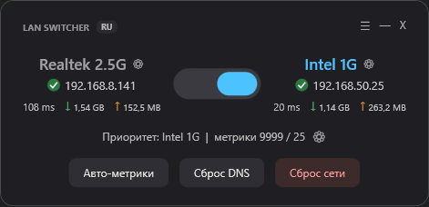
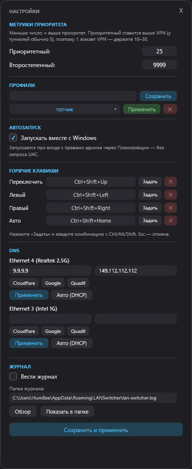
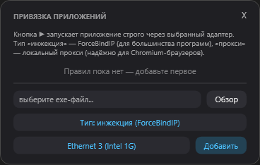

# LAN Switcher

A tiny Windows tray widget that switches, in one click, which of your two network adapters carries the internet — and can pin individual apps to a specific adapter.

Handy when a PC has two network connections — say, two ISPs or two routers — and you want to quickly choose which one is primary and which is backup. It can also force a specific program (a browser, a game, a downloader) to go strictly through a chosen network, without touching the rest of your traffic.

A dark/light, frameless, Windows 11-style window that stays on top, follows the Windows theme, speaks 8 languages, and minimizes to the tray.

## Why I built this

If your PC has two network cards, Windows has no convenient built-in way to switch between them. The stock route — Control Panel → Network and Sharing Center → Change adapter settings, then digging into adapter properties and interface metrics — is buried and clunky, and the modern Settings UI doesn't make working with network adapters any friendlier either. I wanted switching to be a single click, so I made LAN Switcher.



---

## Features

- **Priority switch** — a toggle between the two adapters. A click changes the system metrics (`InterfaceMetric`), and all traffic flows through the chosen network. When both adapters are in automatic mode, the toggle centers ("Auto").
- **Live internet check** — under each adapter, a colored dot shows real connectivity (green = online, yellow = slow, red = no internet, grey = no link) plus the latency in ms. Checked in the background (a bound TCP connect through each adapter), so the UI never freezes.
- **Traffic counter** — cumulative received/sent per adapter (↓/↑) since the PC booted.
- **Per-app adapter binding** — "app → adapter" rules of two kinds: **injection** (via [ForceBindIP](https://r1ch.net/projects/forcebindip), for regular apps) and **proxy** (a built-in local proxy, reliable for Chromium browsers). Includes a traffic check and one-click desktop shortcuts.
- **Settings hub (⚙)** — a scrollable, resizable settings window with:
  - **Metrics** — change the priority numbers (25 / 9999 by default).
  - **Profiles** — save/apply/delete named profiles (a profile stores the priority adapter + metrics, the app rules, and per-adapter DNS). Pick from a dropdown.
  - **Autostart** — start with Windows, elevated and without a UAC prompt (via Task Scheduler).
  - **Hotkeys** — global, configurable shortcuts for Toggle / Left / Right / Auto.
  - **DNS per adapter** — presets (Cloudflare, Google, Quad9), manual entry, or Auto (DHCP).
  - **Logs** — optional log file (with a chosen folder) recording switches, DNS changes, profile actions, resets, etc.
- **Theme follows Windows** — dark or light automatically, no toggle needed.
- **8 languages** — English, Русский, Español, Deutsch, Français, 中文, 日本語, 한국어 — switch with the button next to the title.
- **Network safety buttons** — restore automatic metrics, flush the DNS cache, or a full network-stack reset (with a styled confirmation).
- **Minimize to tray** — the widget hides in the notification area; proxies keep running.

---

## Requirements

- Windows 10 or 11
- At least two network adapters
- Administrator rights (needed to change metrics, DNS, and create the autostart task; requested automatically)
- PowerShell 5.1 (built into Windows) or PowerShell 7+ — the widget uses whichever it finds
- [ForceBindIP](https://r1ch.net/projects/forcebindip) — **only** if you plan to use "injection" rules. Installed separately.

---

## Install & run

Copy the program folder wherever you like. To run, double-click **`LAN-Switcher.exe`** and accept the administrator prompt (UAC).

Program files that must sit next to the exe:

| File | Purpose |
|------|---------|
| `LAN-Switcher.exe` | The widget itself |
| `LAN-Switcher-Proxy.ps1` | Proxy engine (needed for proxy rules) |
| `LAN-Switcher.ico` | Window and tray icon |

User data (rules, settings, profiles, launchers, log) lives separately in `%APPDATA%\LANSwitcher`, so you can move the exe anywhere without losing anything.

---

## Usage

### Switching adapters

Click the toggle (or an adapter's name/block) to switch priority. The active side is highlighted; the dots and latency below reflect live connectivity, and the traffic totals sit under them. The window is draggable; by default it appears in the bottom-right corner.

### Settings (⚙ button)

Opens a scrollable, resizable settings window with sections:



- **Metrics** — the priority number (lower = higher priority) and the secondary one. Both ≥ 1, priority smaller than secondary. "Save and apply" commits them.
- **Profiles** — type a name and **Save** to snapshot the current state (priority + metrics, app rules, per-adapter DNS). Pick a profile from the dropdown, then **Apply** to restore it, or **✕** to delete.
- **Autostart** — a checkbox to start LAN Switcher at logon. It creates a Task Scheduler task with the highest privileges, which runs elevated **without a UAC prompt**.
- **Hotkeys** — assign global shortcuts for Toggle / Left / Right / Auto: click "Set", press a combo with Ctrl/Alt/Shift, Esc to cancel.
- **DNS** — per adapter: preset buttons (Cloudflare / Google / Quad9), manual primary/secondary fields, **Apply**, or **Auto (DHCP)** to revert.
- **Logs** — enable the log and choose its folder; "Show in folder" opens it in Explorer.

> **Important:** don't set the priority metric to `1` if you use a VPN. VPN tunnels usually have metric 5, and a value of 1 would make the physical adapter more important than the tunnel — the VPN would "break". Keep the priority in the 10–30 range.

### App binding (☰ button)

Opens the rules window. Browse for an app's `.exe`, choose the type (injection / proxy) and the adapter, then **Add**.



Each rule has: ▶ launch through the chosen adapter, ? check which adapter its traffic really uses, ↗ create a desktop shortcut, ✕ delete.

### Network buttons

- **Auto metrics** — return both adapters to automatic metric selection (Windows default).
- **Flush DNS** — `ipconfig /flushdns`.
- **Network reset** — full reset: `flushdns` + `netsh winsock reset` + `netsh int ip reset`, behind a styled "Reset / Cancel" confirmation. Requires a reboot.

### Tray & language

The **—** button minimizes to the tray (proxies keep running); double-click the tray icon to restore; exit via **X** or the tray menu (which kills the proxies). The **EN/RU/…** button next to the title cycles through the 8 interface languages.

---

## Two binding methods: the difference

**Injection (ForceBindIP)** launches the app and binds its network sockets to the chosen adapter. The app opens with all its normal settings. Limitations: it can only bind a process it launches (not an already-running one), single-instance apps must be fully closed first, and Microsoft Store (UWP) apps are not supported.

**Proxy** spins up a tiny local proxy server bound to the chosen adapter's IP and launches a Chromium browser through it (`--proxy-server`). This is more reliable for browsers, which are multi-process and resist injection. The browser opens in a separate per-adapter profile — the price of guaranteed proxy application; after a one-time sign-in the profile remembers everything.

---

## Where data is stored

```
%APPDATA%\LANSwitcher\
├── rules.json          — "app → adapter" rules
├── config.json         — metrics, language, autostart, logging, hotkeys, last adapter
├── profiles.json       — saved profiles
├── launchers\          — generated launchers for proxy shortcuts
└── lan-switcher.log    — log file (if logging is enabled; folder configurable)

%LOCALAPPDATA%\LANSwitcher\Profiles\   — separate browser profiles for proxy rules
```

---

## Building from source

The logic is written in PowerShell + WPF (XAML). The `LAN-Switcher.exe` is built from `LAN-Switcher.ps1` via [ps2exe](https://github.com/MScholtes/PS2EXE).

To rebuild after editing the source:

1. Close the widget ("Exit" in the tray).
2. Run **`Build.bat`** (no admin rights needed).

`Build.bat` checks the syntax, installs ps2exe and draws the icon if needed, closes the old instance, and builds a fresh exe with the embedded icon, metadata, and an admin manifest.

You can also run it without compiling — double-click `LAN-Switcher.bat` to run the `.ps1` source directly (handy for testing edits before building, and as a fallback if antivirus won't let the compiled exe through).

### Project files

| File | Purpose |
|------|---------|
| `LAN-Switcher.ps1` | Widget source (all logic + the built-in language pack) |
| `LAN-Switcher-Proxy.ps1` | Proxy engine |
| `LAN-Switcher.exe` | Compiled widget |
| `LAN-Switcher.ico` | Icon |
| `LAN-Switcher.bat` | Run source without compiling |
| `Build.ps1` / `Build.bat` | Rebuild the exe |

---

## How it works (in brief)

- **Priority** is set via `Set-NetIPInterface -InterfaceMetric`, persisted by Windows. On launch, the widget forcibly restores the last selected adapter, so the state is always unambiguous.
- **Internet check** — a background runspace TCP-connects to `1.1.1.1:443` with the outgoing socket bound to each adapter's IP, measuring latency; results are marshaled to the UI so the window never blocks.
- **Injection** — the third-party ForceBindIP utility injects a DLL that intercepts network calls and substitutes the adapter's IP.
- **Proxy** — a small custom HTTP/HTTPS(CONNECT) proxy on .NET sockets binds its outgoing socket to the chosen adapter's IP; HTTPS is tunneled, not decrypted.
- **Autostart** avoids the UAC prompt by using a Task Scheduler task with "highest privileges" that runs at logon.
- **Adapter auto-detection** — the names in the settings are only preferences; if they don't exist, the widget finds two physical adapters itself. Rule bindings are stored by GUID and self-heal when moved to another PC.
- **Translations** are embedded in the script (a `key → per-language string` table), so they ship inside the exe.

---

## Limitations & known caveats

- **Regular (Win32) apps only.** Injection works with classic desktop programs. Microsoft Store (UWP) apps run in a sandbox and are **not supported**.
- **Proxy is for Chromium browsers only** (Chrome, Edge, Brave, Opera, Vivaldi, Yandex and the like). For other apps you can point them at `127.0.0.1:<port>` manually if they support proxies.
- **Injection can't attach to an already-running process** — the app must start through the widget or a shortcut. Single-instance programs must be fully closed first.
- **The proxy browser launches in a separate profile** (otherwise the proxy flag won't apply): no bookmarks/logins the first time, but the profile persists.
- **Possible DNS leak** with the proxy: the hostname is resolved by the system resolver, though the connection to the site still egresses through the chosen adapter. (You can pin a DNS per adapter in Settings.)
- **This is a manual switcher by design** — there is no automatic failover.
- **Administrator rights are required.**
- **Designed for two adapters.** Support for 3+ is on the roadmap.
- **A metric of `1` breaks VPNs** — keep the priority metric in the 10–30 range.
- **`LAN-Switcher.exe` is not code-signed.** On first run Windows SmartScreen may show "unknown publisher" — expected for any unsigned exe (More info → Run anyway). On some PCs antivirus may flag the "local proxy + injection" combo heuristically. In that case, run from source (`LAN-Switcher.bat`) or build the exe yourself with `Build.bat` — the code is open and auditable.
- The project is **not affiliated** with ForceBindIP or ps2exe; those are third-party tools by their respective authors.

---

## License

[MIT](LICENSE) © 2026 HumBearPig

---

## Credits

- [ForceBindIP](https://r1ch.net/projects/forcebindip) — Richard Stanway (used for injection rules).
- [ps2exe](https://github.com/MScholtes/PS2EXE) — Markus Scholtes (compiles the script into an exe).
